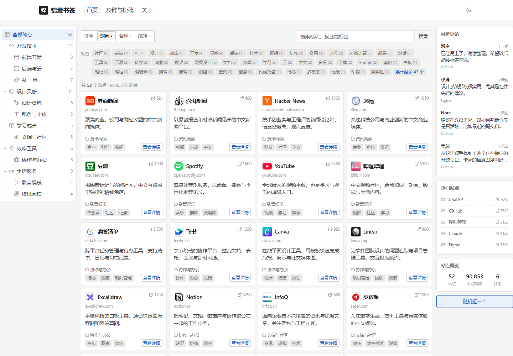
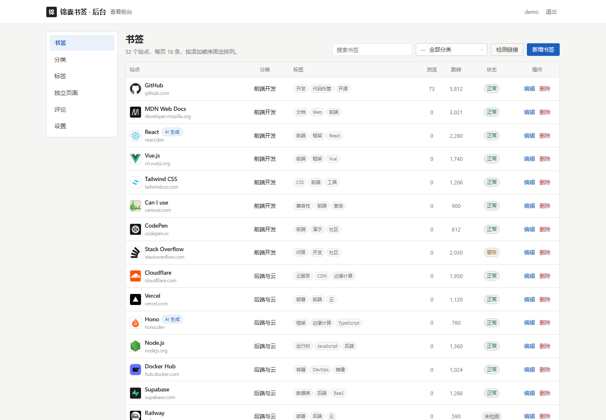
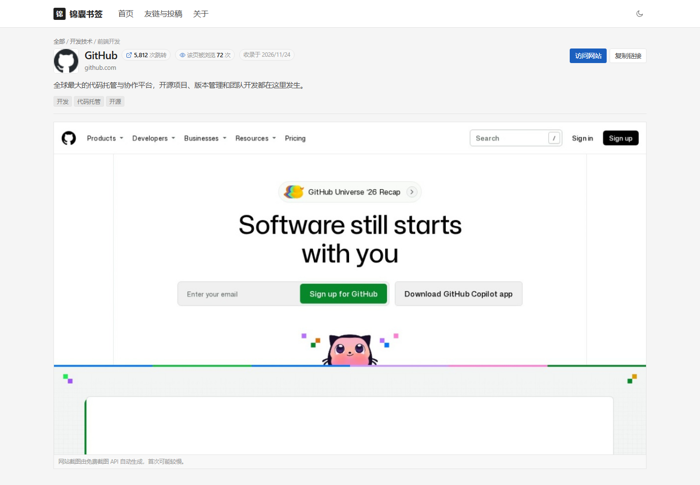

# 锦囊书签 · iNav

一个极简的公开网址导航站，整套服务跑在 **Cloudflare Workers + D1** 上：前台、后台、API、数据库都在一个 Worker 里，不需要服务器，也没有 React 之类的运行时框架。

<p align="center">
  <a href="https://deploy.workers.cloudflare.com/?url=https://github.com/vastroc/iNav">
    
  </a>
</p>



## 一键部署

点上面的按钮，全程在浏览器里完成：不用装 Node、不用命令行、也不用先在本机跑起来。

1. 用 GitHub 和 Cloudflare 账号授权。Cloudflare 会把仓库复制一份到你的账号下，之后所有修改都在那份仓库里。
2. 确认 Worker 名称和 D1 数据库名（默认 `inav`）。数据库、绑定关系、表结构都会自动创建。
3. 按提示填变量：
   - `SESSION_SECRET`：至少 16 位随机串，必须填（`openssl rand -hex 32` 或随手一长串都行）。
   - `ADMIN_GITHUB_LOGINS`：你的 GitHub 用户名，必须填，否则没人能登录后台。
   - `SITE_URL`：可以留空，部署完再补成实际地址。
   - GitHub OAuth 的两个 Key 也可以先空着，见下方「后台登录」。
4. 点 **Deploy**，1~2 分钟后拿到 `https://<worker>.<你的子域>.workers.dev`，前台立即可访问。

每个变量的含义见[环境变量](#环境变量)。想用命令行部署、或者要排错，看 [DEPLOY.md](DEPLOY.md)。

## 功能

**前台**

- 多级分类树 + 卡片流，支持分类图标、标签筛选，按时间 / 名称 / 跳转排序（每个维度可切升降序）。
- 站点卡片显示图标、域名、两行简介、标签与跳转次数；点击标签直达该标签的筛选结果。
- 每个站点都有独立详情页：Markdown 介绍、自动截图、浏览量 / 跳转量 / 收录日期、同分类推荐、独立评论。
- 首页右栏：最近评论、热门站点、站点概览、随机逛一个。
- 深色模式；移动端抽屉菜单（导航 + 分类），顶栏常驻，桌面 / 平板 / 手机三档适配。
- 支持任意数量的 Markdown 独立页面，可发布到顶部导航。

**后台**（`/admin`，仅 GitHub OAuth 登录）

- 书签、分类、标签、独立页面、评论、设置六个模块。
- 标签胶囊编辑器（最多 8 个）、Markdown 预览、分类图标选择器（共 2356 个：精选 404 个 + 单文件 1952 个，全部本地资源）。
- 链接状态检测、AI 简介异步生成与重试、评论审核（含设备 / 浏览器 / IP 属地）。
- 同级分类与独立页面拖拽排序；书签固定按添加顺序。



**数据**

- 浏览（`views`，眼睛图标）= 详情页 / 页面被打开的次数；跳转（`jumps`，箭头图标）= 外链被点开的次数，两者不混用。
- `daily_stats` 一天一行，记录当日浏览与跳转总量。

<p align="center">
  
</p>



## 技术栈

| 层 | 选择 |
| --- | --- |
| 前台 / 后台 | 原生 TypeScript + 原生 DOM，手写 History 路由 |
| 构建 | Vite 多入口 |
| 后端 | Hono，运行于 Cloudflare Workers |
| 数据库 | Cloudflare D1（SQLite） |
| 静态资源 | Workers Static Assets |
| 会话 | HMAC-SHA256 签名的 HttpOnly Cookie |
| Markdown | 项目内置的安全子集渲染器 |

## 后台登录

后台只能用 GitHub 账号登录，需要自己建一个 OAuth App：

1. 打开 <https://github.com/settings/developers> → **New OAuth App**。
2. Homepage URL 填站点地址；Authorization callback URL 填 `https://你的地址/api/auth/github/callback`。
3. 复制 Client ID，再生成一个 Client Secret。
4. 打开 Cloudflare 控制台 → Workers & Pages → 你的 Worker → Settings → Variables and Secrets，把 `GITHUB_CLIENT_ID`、`GITHUB_CLIENT_SECRET` 填进去（`ADMIN_GITHUB_LOGINS` 也在这里改）。
5. 访问 `/admin` 用白名单里的账号登录。

变量改完即时生效，不用重新部署。没有配置 OAuth 时 `/admin` 只会显示提示，不存在其他登录入口。

## 自动部署（push 即上线）

用按钮创建的 Worker 已经通过 Workers Builds 连上了仓库，之后改代码只要推到 `main`：

1. 本地改完提交，或在 GitHub 网页上直接编辑。
2. `git push` 后自动构建、执行 D1 迁移并部署，1~2 分钟完成。
3. 控制台 Deployments 里能看每次的日志、重试，也能回滚到任一历史版本。

如果是手动接入（Workers & Pages → 你的 Worker → Settings → Build → Connect to Git），配置保持默认即可，命令直接读 `package.json`：

| 配置 | 值 |
| --- | --- |
| Build command | `npm run build` |
| Deploy command | `npm run deploy` |
| 环境变量 | `NODE_VERSION=22` |

- `npm run deploy` = 类型检查与打包 + 远程 D1 迁移 + `wrangler deploy`，改了表结构会跟着一起上线。
- 构建失败不影响线上正在跑的版本。
- 仓库里还附了一份 GitHub Actions 工作流（备选方案）：没配 `CLOUDFLARE_API_TOKEN` 时会自动跳过，不会报错；真要接 Actions 就按 DEPLOY.md 配好 Token 并关掉 Workers Builds，两者同时开会让一次 push 部署两次。

## 绑定自定义域名

`*.workers.dev` 可以直接用；想要好记的域名（也更利于收录）按下面做：

1. 域名的 Nameserver 指向 Cloudflare，和 Worker 在同一个账号下。
2. Workers & Pages → 你的 Worker → Settings → Domains & Routes → Add → **Custom domain**，填 `nav.example.com`。DNS 记录和 HTTPS 证书会自动配好，通常 1~3 分钟生效，不用改代码也不用重新部署。
3. 把 `SITE_URL` 改成 `https://nav.example.com`（Settings → Variables and Secrets），sitemap 和 OAuth 回跳都靠它。
4. 回到 GitHub OAuth App，把 Homepage URL 和 Callback URL 换成新域名，否则后台登录会报 `redirect_uri_mismatch`。
5. 用新域名打开首页和 `/admin` 确认正常。原来的 `*.workers.dev` 可以继续访问，不用关。

## 环境变量

线上在 Worker 的 Variables and Secrets 里配置，本地写在 `.dev.vars`。

| 变量 | 必需 | 说明 |
| --- | --- | --- |
| `SESSION_SECRET` | 是 | 至少 16 字符随机串，用于会话签名、验证码、IP 摘要 |
| `SITE_URL` | 推荐 | 站点公开地址，用于 sitemap、CSRF 校验、OAuth；留空时按请求域名推断，必须与实际访问地址完全一致 |
| `GITHUB_CLIENT_ID` | 是 | GitHub OAuth App Client ID |
| `GITHUB_CLIENT_SECRET` | 是 | GitHub OAuth App Secret |
| `ADMIN_GITHUB_LOGINS` | 是 | 管理员 GitHub 用户名，逗号分隔 |
| `AI_API_KEY` | 否 | AI 简介的通用 Key，各供应商专用 Key 缺失时兜底 |
| `DASHSCOPE_API_KEY` / `ARK_API_KEY` / `DEEPSEEK_API_KEY` / `OPENAI_API_KEY` / `GEMINI_API_KEY` | 否 | 对应供应商的专用 Key |

AI 供应商、模型和提示词在后台「设置 → AI 简介」里改，不配 Key 也能用免费的 Pollinations。

## 数据模型

| 表 | 用途 |
| --- | --- |
| `categories` | 多级分类、图标、排序 |
| `sites` | 站点、标签 JSON、详情 Markdown、浏览量 `views`、跳转量 `jumps`、链接状态、AI 状态 |
| `pages` | 独立页面 + 内置首页/关于页，浏览量存在 `views` |
| `comments` | 站点/页面评论、审核状态、IP 摘要、设备与浏览器解析结果 |
| `daily_stats` | 每日浏览与跳转总量 |
| `settings` | 站点信息、SEO、评论策略、AI、管理员 |

迁移只有一个全量文件 `migrations/0001_init.sql`：新库直接建成最终结构，改结构就改它，没有增量补丁。

## 本地开发（可选）

只想把站跑起来不用看这节。要改代码时才需要：Node.js **22.12+**。

```bash
npm install
npm run setup    # 建本地 D1 并写入演示数据
npm run dev      # http://127.0.0.1:8787
```

要调后台，复制 `.dev.vars.example` 为 `.dev.vars` 填好 OAuth 凭据，回调地址填 `http://127.0.0.1:8787/api/auth/github/callback`。

如果需要清除本地数据库数据：

```bash
npm run db:reset
npm run dev
```

## 目录结构

```text
index.html                 前台入口
admin.html                 后台入口
src/public/main.ts         前台路由、渲染、评论、统计
src/admin/main.ts          后台全部逻辑
src/lib/markdown.ts        安全 Markdown 渲染器
worker/index.ts            Worker 入口（Hono）、安全头、/go、/admin、sitemap
worker/public.ts           导航、详情、页面、评论、验证码、浏览量
worker/admin.ts            后台接口
shared/types.ts            前后端共享类型
migrations/0001_init.sql   全量初始化脚本
scripts/                   演示数据、图标生成与校验、本地库重建、API 冒烟
public/                    图标精灵、单图标、headers、robots、主题脚本
```

二次开发约定、产品决策与实现细节见 **[AGENTS.md](AGENTS.md)**，完整部署步骤见 **[DEPLOY.md](DEPLOY.md)**。

## 已知边界

- 详情页截图走免费的 mShots，失败自动切 `image.thum.io`，都不可用时显示占位；可在后台手填截图地址。
- 站点图标优先用后台手填地址，否则读取 Google gstatic CN，失败显示首字母。
- 跳转计数依赖浏览器 `fetch(..., { keepalive: true })`，禁用 JavaScript 或拦截请求时会少计。
- 前台不展示链接在线状态，检测结果只留在后台；没有定时任务，只在保存站点和手动点击时检测。
- AI 简介是 `waitUntil` 异步任务，超时或失败会落到 `ai_error`，可在后台点「重试」。

## 致谢

- 分类图标来自 [Lucide](https://lucide.dev/)（ISC License），产物已内置在仓库，不请求外部 CDN。
- 运行平台：[Cloudflare Workers](https://workers.cloudflare.com/)、[D1](https://developers.cloudflare.com/d1/)。

## 许可

[CC BY-NC-SA 4.0](LICENSE)（署名 — 非商业性使用 — 相同方式共享 4.0 国际）。

- **可以**：阅读、克隆、修改代码，部署自己的非商业站点（个人收藏、学习、内部工具、非营利项目）。
- **必须**：保留署名并注明改动；二次开发的作品要以同样许可公开，不能闭源后再分发。
- **不可以**：直接或改造后用于商业目的（收费服务、商业产品、带广告或付费墙的站点）。商用请通过仓库 Issue 联系单独授权。

注意这是「源码可见」许可，不是 OSI 定义的开源许可——它限制商业使用，所以不要把它当作开源项目引用。随附的第三方资源保持各自许可：Hono / Vite / Wrangler 为 MIT，Lucide 为 ISC（见 `public/category-icons.LICENSE.txt`）。
